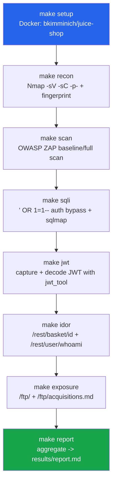

# vapt-pipeline

An automated, reproducible **Vulnerability Assessment & Penetration Testing
(VAPT)** pipeline that chains the tools used in our Honours Lab assessment
against the **OWASP Juice Shop**, submitted alongside our demo and report.

**Course:** Vulnerability Assessment & Penetration Testing, Sem VII, KJSSE
**Authors:** Ananya Dhiman (16010123041), Anoushka Nelson (16010123049)

---

## ⚠️ Legal & Ethical Use

> **This repository is for educational use only.**
>
> - The only intended target is the **OWASP Juice Shop** container
>   (`bkimminich/juice-shop`) run **locally** by you, at
>   `http://localhost:3000`. Juice Shop is an intentionally vulnerable
>   application built by OWASP specifically for security training —
>   attacking it in this way is legal and expected.
> - **Never** point any script in this repository at a host, domain, or
>   network you do not own and do not have explicit written authorization
>   to test. Unauthorized scanning or exploitation of third-party systems is
>   illegal in most jurisdictions.
> - This pipeline is a teaching artifact for a university lab; it is not
>   intended to be used as an attack tool against production systems.

By running `run_pipeline.sh` or any `make` target, you confirm the target is
the local Juice Shop instance described above.

---

## What this does

A single command spins up the target, runs each phase of the assessment in
order, saves every tool's raw output under `results/`, and produces a
consolidated findings report at `results/report.md`.

```
./run_pipeline.sh
```

### Pipeline flow



---

## Prerequisites

Install these before running the pipeline (Linux / WSL recommended — Nmap,
sqlmap and jwt_tool are native CLI tools):

| Tool | Purpose | Install |
|------|---------|---------|
| Docker | Runs Juice Shop and OWASP ZAP | `https://docs.docker.com/get-docker/` |
| Nmap | Recon / service scan | `sudo apt install nmap` |
| curl, jq | Scripted HTTP requests + JSON parsing | `sudo apt install curl jq` |
| sqlmap | Automated SQLi confirmation | `sudo apt install sqlmap` (or `pip install sqlmap`) |
| jwt_tool (ticarpi) | JWT decoding/analysis | `git clone https://github.com/ticarpi/jwt_tool tools/jwt_tool && pip3 install -r tools/jwt_tool/requirements.txt` |
| Python 3 | Report generation (stdlib only) | `sudo apt install python3` |

Each phase script checks for its own dependencies and prints an install hint
and exits cleanly if something is missing, instead of failing midway.

---

## Quick start

```bash
# Run the entire pipeline end to end
./run_pipeline.sh

# ...or run phases individually
make setup      # start Juice Shop, wait for it to be healthy
make recon      # Nmap scan + app fingerprint
make scan       # OWASP ZAP baseline/full scan
make sqli       # auth-bypass PoC + sqlmap confirmation
make jwt        # capture + decode session JWT
make idor       # IDOR probe against /rest/basket/{id}
make exposure   # unauthenticated /ftp/ disclosure
make report     # aggregate everything into results/report.md

make clean      # stop/remove the container, clear results/
```

Configuration (target URL, container/image names, ZAP scan mode, etc.) lives
in [`config/target.env`](config/target.env) — edit it rather than the
scripts if you need to change ports or scan modes.

---

## Tools used

| Tool | What it is | Role in this pipeline |
|------|------------|------------------------|
| **Docker / Juice Shop** | Container runtime / OWASP's deliberately vulnerable training app | Provides a disposable, reproducible target (`scripts/00_setup.sh`) |
| **Nmap** | Network/service scanner | Fingerprints open ports, service versions, and runs default NSE scripts against the target (`scripts/01_recon.sh`) |
| **OWASP ZAP** | Automated web app security scanner | Runs a baseline/full scan over the whole app and exports an HTML + JSON findings report (`scripts/02_zap_scan.sh`) |
| **Burp Suite** | Interactive web proxy/scanner | Used **manually** during the live demo to intercept/replay requests (login bypass, token tampering) — not scripted here, since it's a GUI-driven tool |
| **sqlmap** | Automated SQL injection tool | Confirms boolean-based blind SQLi on the login endpoint's `email` parameter against the SQLite backend (`scripts/03_sqli.sh`) |
| **jwt_tool (ticarpi)** | JWT analysis/attack tool | Decodes the session token issued after the auth-bypass login, surfacing the `role: admin` claim (`scripts/04_jwt.sh`) |

---

## Attacks demonstrated

### 1. SQL Injection — login auth-bypass

- **Attack:** Submitting `' OR 1=1--` as the login email short-circuits the
  SQL `WHERE` clause used to look up credentials, logging the attacker in as
  the first user in the database (the Juice Shop admin).
- **Reproduced by:** `scripts/03_sqli.sh` — a scripted `curl` POST to
  `/rest/user/login` with the payload, plus `sqlmap -p email` against the
  same JSON body to confirm boolean-based blind SQLi on SQLite.
- **Impact:** Full authentication bypass; attacker obtains an admin session
  without any valid credentials.
- **Mapping:** OWASP Top 10 **A03:2021 – Injection** / **CWE-89**.
- **Remediation:** Use parameterised queries / an ORM with bound parameters
  everywhere user input reaches SQL; never build queries by string
  concatenation.

### 2. Broken Access Control — IDOR

- **Attack:** With a valid bearer token, requesting `/rest/basket/{id}` for
  basket IDs that do not belong to the authenticated user still returns
  their contents — the server trusts the client-supplied ID instead of
  checking ownership.
- **Reproduced by:** `scripts/05_idor.sh` — calls `/rest/user/whoami` to
  establish identity, then walks a range of basket IDs with the same token.
- **Impact:** Any authenticated user can read (and, depending on the
  endpoint, modify) other users' shopping baskets.
- **Mapping:** OWASP Top 10 **A01:2021 – Broken Access Control** / **CWE-639**.
- **Remediation:** Enforce server-side authorization on every object access
  — verify the authenticated principal actually owns the requested resource.

### 3. Sensitive Data Exposure — `/ftp/` directory listing

- **Attack:** The `/ftp/` path is served with directory listing enabled and
  no authentication, exposing `acquisitions.md`, a confidential internal
  document, to anyone.
- **Reproduced by:** `scripts/06_exposure.sh` — unauthenticated `curl`
  requests to `/ftp/` and `/ftp/acquisitions.md`.
- **Impact:** Disclosure of confidential business information to
  unauthenticated users.
- **Mapping:** OWASP Top 10 **A05:2021 – Security Misconfiguration** / **CWE-548**.
- **Remediation:** Disable directory listing/autoindex, and never expose
  internal file shares from the public web root.

### 4. Weak JWT Handling

- **Attack:** The session JWT issued after the auth-bypass login carries a
  `role: admin` claim that is trivially readable (and, if the signing key is
  weak/guessable, forgeable) by decoding the token.
- **Reproduced by:** `scripts/04_jwt.sh` — captures the token from the login
  response and decodes it with `jwt_tool`, surfacing the role claim.
- **Impact:** Privilege information is exposed client-side; weak or
  predictable signing would let an attacker forge arbitrary roles.
- **Mapping:** OWASP Top 10 **A02:2021 – Cryptographic Failures** / **CWE-347**.
- **Remediation:** Sign JWTs with a strong, server-held secret/key; always
  validate signature + claims server-side; never trust client-decoded claims
  for authorization decisions.

### 5. Security Misconfiguration (ZAP findings)

- **Attack:** Passive + active scanning surfaces missing security headers
  (CSP, `X-Content-Type-Options`, HSTS), permissive CORS, and other
  out-of-the-box misconfigurations.
- **Reproduced by:** `scripts/02_zap_scan.sh` — ZAP baseline/full scan,
  exported to `results/zap/zap_report.html` / `.json`.
- **Impact:** Weakens defense-in-depth; increases exposure to XSS, clickjacking,
  and cross-origin data leakage.
- **Mapping:** OWASP Top 10 **A05:2021 – Security Misconfiguration** / **CWE-693**.
- **Remediation:** Apply standard security headers, lock down CORS to known
  origins, and remove default/verbose configuration before deployment.

### 6. Information Disclosure (recon)

- **Attack:** Nmap's service/script scan and a basic HTTP fingerprint reveal
  service versions, framework banners, and verbose response headers.
- **Reproduced by:** `scripts/01_recon.sh` — `nmap -sV -sC -p- localhost`
  plus an HTTP header/title fingerprint.
- **Impact:** Version/technology disclosure helps an attacker target known
  CVEs for the exact stack in use.
- **Mapping:** OWASP Top 10 **A05:2021 – Security Misconfiguration** / **CWE-200**.
- **Remediation:** Strip verbose banners and stack traces from responses,
  minimize disclosed version info, and handle errors generically in
  production.

---

## Where outputs land

```
results/
├── logs/                        # per-phase stdout logs
├── recon/
│   ├── nmap_full.txt / .xml     # Phase 2: Nmap output
│   └── fingerprint.txt          # Phase 2: HTTP header/title fingerprint
├── zap/
│   ├── zap_report.html          # Phase 3: ZAP findings (human-readable)
│   ├── zap_report.json          # Phase 3: ZAP findings (machine-readable)
│   └── zap_report.md
├── sqli/
│   ├── auth_bypass_response.json   # Phase 4: raw login response
│   └── sqlmap_output.txt           # Phase 4: sqlmap confirmation
├── jwt/
│   ├── token.txt                # Phase 5: captured bearer token
│   └── decoded_token.txt        # Phase 5: jwt_tool decode output
├── idor/
│   ├── whoami.json              # Phase 6: authenticated identity
│   ├── basket_<id>.json         # Phase 6: per-basket-ID responses
│   └── basket_idor_summary.txt  # Phase 6: summary table
├── exposure/
│   ├── ftp_directory_listing.html
│   ├── acquisitions.md
│   └── evidence_summary.txt
└── report.md                    # Phase 8: consolidated final report
```

To read the final writeup: open **`results/report.md`** after `make all` (or
`./run_pipeline.sh`) completes — it inlines the key evidence from every phase
plus the findings-to-OWASP-Top-10/CWE mapping table.

---

## Repo layout

```
README.md            this file
LICENSE
.gitignore
Makefile              setup / recon / scan / sqli / jwt / idor / exposure / report / all / clean
run_pipeline.sh        top-level entry point (runs `make all`)
config/
  target.env           target URL, container/image names, scan mode, credentials
scripts/
  lib.sh               shared helpers (logging, dependency checks, HTTP/JWT utilities)
  00_setup.sh           Phase 1
  01_recon.sh           Phase 2
  02_zap_scan.sh        Phase 3
  03_sqli.sh            Phase 4
  04_jwt.sh             Phase 5
  05_idor.sh            Phase 6
  06_exposure.sh        Phase 7
  07_report.py          Phase 8
results/                gitignored (except .gitkeep placeholders) — all raw output lands here
docs/                   optional supplementary notes
```
